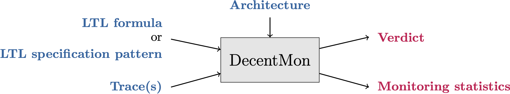

DecentMon is an OCaml Benchmark for Decentralized Monitoring of LTL formulae.
DecentMon is written in the functional programming language OCaml.

DecentMon takes as input:

- some LTL formulae to be monitored or some LTL Specification patterns (see the Specification Patterns Website);
- some traces against which the formulae are monitored;
- an architecture given by a distributed alphabet indicating how components are organised and distributed in the system.

The iterations of DecentMon served to produce experimental results for several publications:






[Link to the repo](https://gricad-gitlab.univ-grenoble-alpes.fr/falconey/decentmon).
